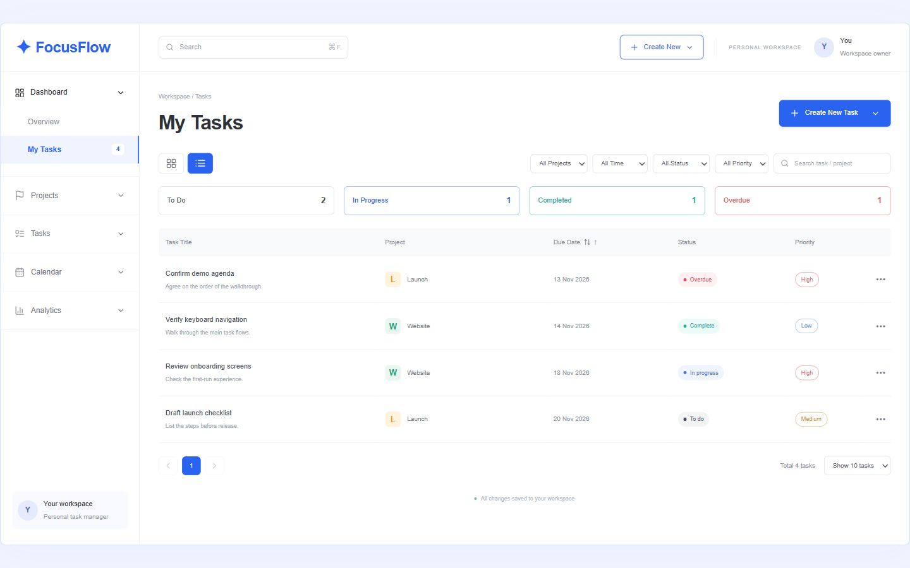
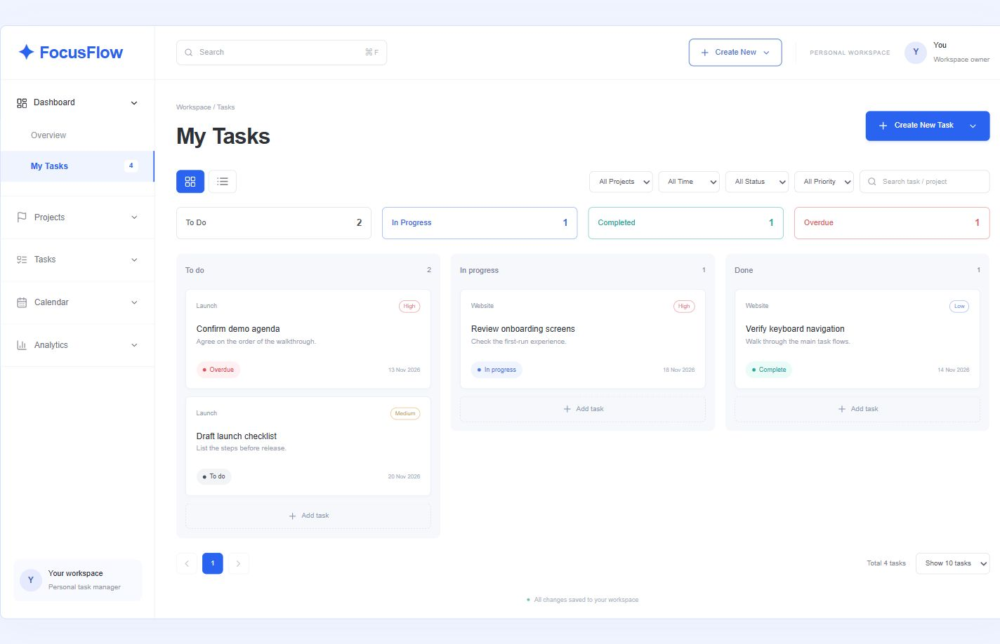
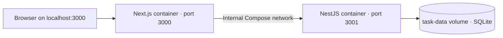
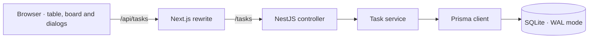
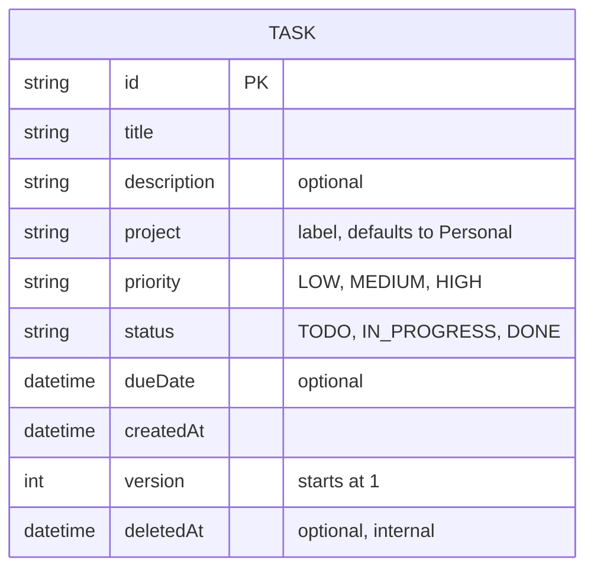
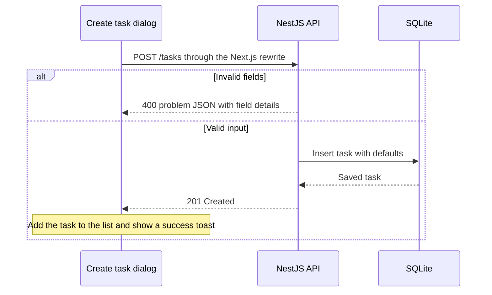
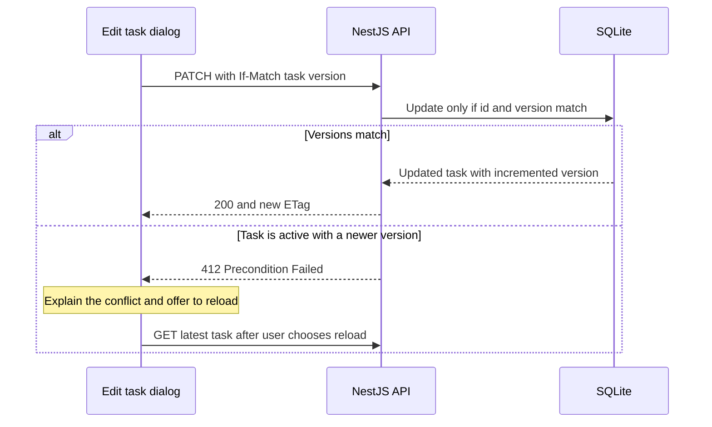
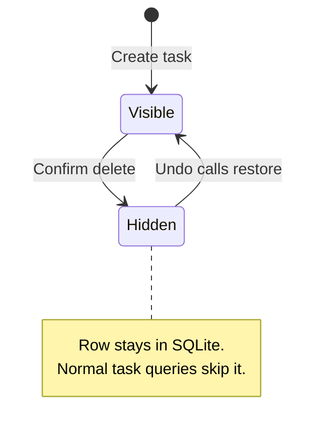
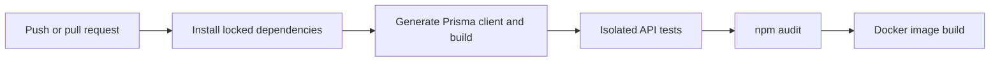
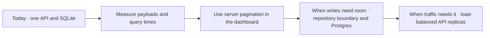

# FocusFlow

**See what needs your attention. Pick what to do next.**

FocusFlow is a personal task manager with two views of the same work. Use the table to find what’s due or the board to see what’s moving. If you delete a task by mistake, use **Undo**. If another tab saves an edit before you do, FocusFlow asks you to reload the newer version.

[Take the tour](#take-the-tour) · [Run it locally](#run-it-locally) · [How it works](#how-it-works) · [API reference](#api-reference) · [Verify the project](#verify-the-project)

## Take the tour



**Table view.** Start with **Overdue** to see what needs attention. Narrow the list by project, status, priority, or due date. Search by task title, project, or description, then use the **Due Date** column to sort.



**Board view.** See which tasks are waiting, underway, or finished. Open any card and change its status in the edit dialog. The board and table show the same saved tasks.

The screenshots show the running app with fictional sample tasks. To try the workflow, create a task called **Review homepage**, set its project to **Website**, give it a due date, and save it. Switch to the board, open the card, and mark it **In progress**. Return to the table, delete it from the row menu, then select **Undo** in the notification.

## Run it locally

Use **Node.js 24.13.0** (see [`.nvmrc`](.nvmrc)) and npm. Clone the repo, then run these commands from its root. On macOS or Linux use `cp` in place of `Copy-Item`.

```powershell
git clone https://github.com/Dhilluckshan/focus-flow.git
cd focus-flow
Copy-Item backend/.env.example backend/.env
npm ci --prefix backend
npm ci --prefix frontend
npm run db:setup --prefix backend
npm run build
```

Start the API and web app in separate terminals from the repo root.

```sh
# Terminal 1
npm start --prefix backend

# Terminal 2
npm start --prefix frontend
```

Open [the dashboard](http://localhost:3000). The direct API is at [localhost:3001/tasks](http://localhost:3001/tasks). A new database starts empty. The setup command generates the Prisma client and applies pending migrations, including the migration that adds versioning and reversible deletion to existing tasks.

| Setting | Default | Purpose |
| --- | --- | --- |
| `DATABASE_URL` | `file:./dev.db` | Prisma’s SQLite file, relative to the schema directory for this default. Start with [the backend environment example](backend/.env.example). |
| `PORT` | `3001` | API listen port. Set it in the API process environment to change it. |
| `FRONTEND_ORIGIN` | `http://localhost:3000` | Allowed origin for cross-origin browser requests. Set it in the API process environment when needed. |
| `API_INTERNAL_URL` | `http://127.0.0.1:3001` | Next.js rewrite target. Set it before building the frontend when using a different API address. |

For frontend development, use `npm run dev --prefix frontend` while the API is running. If the dashboard can’t load tasks, check the direct API URL first. After changing the rewrite target, rebuild the frontend.

### Run with Docker Compose

With Docker Engine or Docker Desktop running Linux containers and ports 3000 and 3001 free:

```sh
docker compose up --build -d
docker compose ps
# Stop both services when finished
docker compose down
```

The API applies migrations on startup. Compose waits for a successful `GET /tasks` before starting the frontend. The named `task-data` volume keeps the SQLite database across ordinary container restarts and `docker compose down`.



## How it works

### One request, three layers



| Layer | Responsibility |
| --- | --- |
| **Web** | The Next.js App Router renders the workspace. React manages filters and task interactions. Tailwind styles the UI, Radix primitives support dialog focus handling, and Sonner displays feedback and Undo. [Dashboard source](frontend/app/page.tsx) |
| **API** | NestJS checks the request shape, reads HTTP headers, and routes work to the task service. The service applies lifecycle rules and translates missing records and conflicts into HTTP errors. [Controller](backend/src/tasks.controller.ts) · [Service](backend/src/tasks.service.ts) |
| **Database** | Prisma sends typed queries to SQLite. SQLite keeps data in one file. Write-ahead logging (WAL) lets reads continue during writes in normal operation, while writes still take turns. [Schema](backend/prisma/schema.prisma) |

The browser always talks to the web app’s origin. Next.js forwards the request and sends the API response back. That keeps the internal API address out of browser-side configuration.

### What a task stores



Project is a label stored on each task. **Overdue** is calculated in the dashboard when a task is unfinished and its due date has passed. Undated tasks appear last in due-date sorting. Dates selected in the UI are sent at noon UTC and displayed as UTC calendar dates.

### Save a task



### When two tabs edit the same task

Imagine both tabs open version 1. The first save writes version 2. The second tab still sends version 1, so the database can refuse the stale write. The check and the update happen in one database operation, which prevents a second write from slipping between them.



### How Undo brings a task back



The delete request sets a timestamp. Restore clears it. The dashboard offers Undo in the success toast, and the API can restore a deleted task by ID.

## API reference

All paths below are relative to the direct API at `http://localhost:3001`.

| Method | Path | Result |
| --- | --- | --- |
| GET | `/tasks` | `200` with the task array. Requests with query options return a paginated result. |
| GET | `/tasks/:id` | `200` with the active task and its version ETag. |
| POST | `/tasks` | `201` with the new task. |
| PATCH | `/tasks/:id` | `200` with updated task and ETag. An optional `If-Match` protects against stale edits. |
| DELETE | `/tasks/:id` | `204` and an empty response. Hides the task. |
| POST | `/tasks/:id/restore` | `200` with the restored task. |

**Write fields.** `title` is required on create and trimmed to a non-empty value of at most 160 characters. `description` is optional and accepts up to 5,000 characters. `project` is a label of 1–80 characters. `dueDate` accepts an ISO 8601 date or date-time. Send `null` to clear a description or due date. Defaults are `Personal` for project, `MEDIUM` for priority and `TODO` for status. PATCH accepts a subset of the writable fields.

**List options.** Use `status`, `search`, `sort` (`dueDate` or `createdAt`), `direction` (`asc` or `desc`), `limit` (1–100), and `cursor`. The paged response contains `items`, `total`, and `nextCursor`. Pass the cursor back with the same filters and sorting. A null cursor means you’ve reached the end. Task ID breaks ties when dates match. If a cursor disappears or no longer matches the filter, restart from page one.

```sh
curl "http://localhost:3001/tasks?status=TODO&sort=dueDate&direction=asc&limit=5"
```

**Errors.** Invalid fields and unknown inputs return `400`. Missing or hidden tasks return `404` on normal task routes. A stale conditional edit returns `412`. Error bodies use `application/problem+json` with a request ID, and validation responses include field-level details.

## Verify the project

After installing dependencies and generating Prisma Client, run:

```sh
npm run build
npm run test:isolated
```

The isolated runner uses a fresh SQLite database, applies migrations, starts its own API on port 3191, and cleans up afterward. Set `TEST_API_PORT` if that port is occupied. The tests cover CRUD, defaults, validation, missing tasks, legacy and paginated lists, stale edits, and restore. If you already have a dedicated test API running, set `API_URL` to its `/tasks` URL and use `npm test`.



Fresh-clone installation, migrations, production builds, API tests, and HTTP smoke checks have been verified locally. Browser automation, accessibility scoring, coverage gates, mutation testing, and OpenAPI conformance are future checks. Docker Compose startup has not been verified locally. [CI workflow](.github/workflows/checks.yml)

## Design decisions and limits

| Decision | What you get | Trade-off |
| --- | --- | --- |
| **SQLite with Prisma** | Typed queries and migrations with one local database file. | Concurrent writes share one SQLite writer. |
| **Opt-in cursor pagination** | API callers can cap response sizes without breaking clients that expect an array. | The dashboard still uses the array and filters it in the browser. API substring search and exact totals can scan matching rows. |
| **Versioned edits and soft delete** | A stale tab cannot silently overwrite a newer save when it supplies a version. Undo can recover a deleted task. | Older API clients can omit `If-Match`, and hidden rows need a retention policy for public use. |
| **One local workspace** | Open the app and start creating tasks without an account. | Before public deployment, add authentication, task-level authorization, rate limiting, and monitoring. |

The validation pipe rejects unknown fields. Prisma builds task queries, the WAL statement is constant, and unexpected errors return generic details. The configured CORS origin governs cross-origin browser access. Environment values and local databases are ignored by Git. CI is configured to audit npm dependencies. Container scans, secret scanning, and a software bill of materials remain future work.

### What to measure and change as it grows

There are no published load-test or Lighthouse results. Start by measuring payload sizes, API throughput, errors, and latency percentiles with the same synthetic data and concurrency on each revision. Record the machine and runtime so the results can be reproduced.



Keep the SQLite file local to one host. Once shared storage is needed, move persistence behind a repository interface and migrate to Postgres. Add shared rate limits, read replicas, or a background queue when measurements justify them. A future realtime feature would also need a way to share events across replicas.

## How I used AI

I used Codex to draft parts of the API, dashboard, regression tests, and documentation. I can use the code and diagrams above to trace each request and explain the trade-offs. **Author review note:** add the specific suggestions you accepted, changed, or rejected and the checks you ran yourself before submitting.
