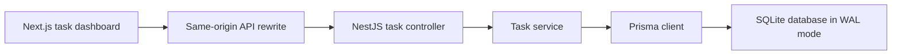
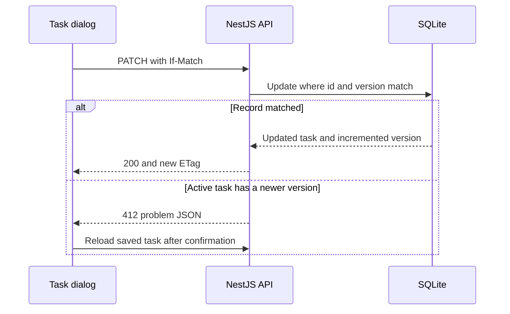

# FocusFlow architecture

The controller parses HTTP metadata, global validation checks input, and the service owns task lifecycle and queries. The API translates exceptions into problem JSON. Native SQLite migrations add task version and deletion fields without rewriting existing tasks.

## Decisions

| Decision | Reason |
| --- | --- |
| Keep Prisma and SQLite | Migrations and typed queries support a reproducible local setup without another service. |
| Use WAL and compound indexes | WAL supports readers during short writes. Indexes follow the live-task filter and sort columns. |
| Make paging opt-in | Existing consumers expect an array. Query parameters select the paged envelope. |
| Cursor with a stable ID tie-breaker | Ordering stays deterministic when dates match. A removed or filtered cursor returns 400 and the caller can restart pagination. |
| Return problem JSON and a request ID | Clients can show field errors and match a failed request to its response headers. |
| Conditional update in one database statement | Checking the version inside the write closes the race between separate read and write calls. |
| Soft delete and explicit restore | Undo survives page refreshes at the API level and keeps task history intact. |
| Reuse existing Radix and Sonner UI | Accessible dialog primitives and toast actions already exist in the app. |

The dashboard still uses the legacy list and local filters. Substring search scans the relevant candidate rows. SQLite is suitable for this single-instance deployment. A larger deployment would need Postgres, shared rate-limit state, and a separate event fan-out mechanism before adding more API replicas.
